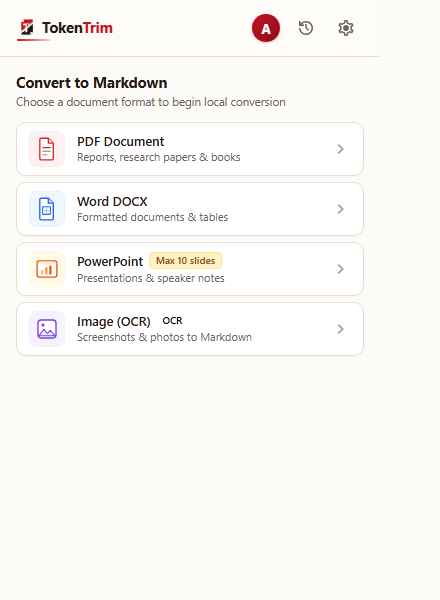
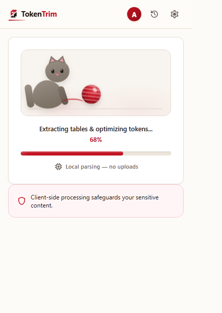
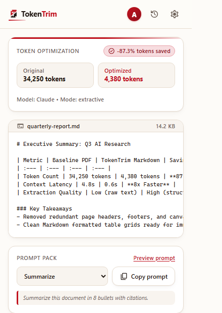

# TokenTrim — AI-Optimized Document Preprocessor

<div align="center">


### **Trim Document Tokens by 60–85% Before Sending to Claude, ChatGPT, or Gemini**
**100% Client-Side · Zero Server Uploads · Instant Local Markdown Extraction**

[](https://github.com/Deepan9884/TokenTrim-Extension)
[](https://developer.chrome.com/docs/extensions/mv3/)
[](https://opensource.org/licenses/MIT)
[](https://github.com/Deepan9884/TokenTrim-Extension)

[**Download Ready-to-Install ZIP**](TokenTrim-Extension.zip) • [**Quick Installation**](#-quick-installation-guide) • [**How It Works**](#-how-it-works--live-demo) • [**Supported Formats**](#-supported-formats--benchmarks) • [**Privacy Guarantee**](#-privacy--security-architecture)

</div>

---

## ⚡ The Problem: LLM Token Overload
When you upload raw PDFs, Word documents, presentations, or spreadsheets to LLMs (Claude, ChatGPT, Gemini, DeepSeek):
1. **Bloated Context Windows**: Headers, footers, page numbers, duplicate XML wrappers, and decorative tables consume thousands of unnecessary tokens.
2. **Context Degradation ("Lost in the Middle")**: Long, noisy documents degrade LLM reasoning and cause hallucinations.
3. **Expensive API Costs & Rapid Rate Limits**: You hit token caps and message quotas 3x faster than necessary.

### 💡 The Solution: TokenTrim
**TokenTrim** is a lightweight, zero-latency browser extension that preprocesses any document right inside your browser. It extracts structure, cleans repetitive noise, and converts the document into high-density, prompt-ready Markdown tuned for your target AI model — **saving between 60% and 85% of token overhead**.

---

## 📸 Visual Walkthrough & Demo

| 1. Drag & Drop Document | 2. Instant Local Processing | 3. High-Density AI Markdown |
|:---:|:---:|:---:|
|  |  |  |
| *Supports PDF, Word, Excel, Slides & Images* | *Client-Side WASM / OCR Parser* | *60–85% tokens saved, 1-click copy* |

---

## 🚀 Quick Installation Guide

No developer tools or terminal commands required! You can install TokenTrim in 30 seconds:

### Step 1: Download the Extension ZIP
Download [`TokenTrim-Extension.zip`](TokenTrim-Extension.zip) directly from this repository (or from the [Releases](https://github.com/Deepan9884/TokenTrim-Extension/releases) page).

### Step 2: Unzip the Archive
Extract `TokenTrim-Extension.zip` into a folder on your computer (for example, `Downloads/TokenTrim-Extension`).

### Step 3: Load into Your Chromium Browser

#### For Google Chrome:
1. Open Chrome and go to `chrome://extensions` in the address bar.
2. In the top-right corner, switch the **Developer mode** toggle to **ON**.
3. In the top-left corner, click **Load unpacked**.
4. Select the extracted `TokenTrim-Extension` folder.

#### For Brave Browser:
1. Go to `brave://extensions`.
2. Enable **Developer mode** in the top right.
3. Click **Load unpacked** and select the extracted folder.

#### For Microsoft Edge:
1. Go to `edge://extensions`.
2. Toggle on **Developer mode** (left sidebar).
3. Click **Load unpacked** and select the extracted folder.

#### For Arc Browser:
1. Go to `arc://extensions`.
2. Enable **Developer mode**.
3. Click **Load unpacked** and select the extracted folder.

### Step 4: Pin TokenTrim
Click the puzzle piece icon (Extensions) in your browser toolbar and click the **Pin** icon next to **TokenTrim**.

---

## 🎮 Complete Demo Walkthrough

Here is how you use TokenTrim on any web page (ChatGPT, Claude, Google Docs, etc.):

```text
[ Raw PDF / DOCX / Image ]
            │
            ▼
┌──────────────────────────────────────┐
│       TokenTrim Extension Popup      │
│  • Select AI Model Preset            │
│  • Choose Page Range (Optional)      │
│  • Local WASM / OCR Parser           │
└──────────────────────────────────────┘
            │
            ▼  (60% - 85% Token Reduction)
┌──────────────────────────────────────┐
│     Clean Prompt-Ready Markdown      │
│  • Strip headers, footers & noise    │
│  • Clean markdown tables             │
│  • One-click "Copy Clean Markdown"   │
└──────────────────────────────────────┘
            │
            ▼
[ Paste directly into Claude / ChatGPT / Gemini ]
```

1. **Open TokenTrim**: Click the TokenTrim extension icon in your browser toolbar.
2. **Select AI Preset**:
   * **Claude**: Optimized for hierarchical headers and XML tags.
   * **GPT-4o**: Compact bulleted markdown with token minimization.
   * **Gemini**: Clean structural markdown with standard table layout.
   * **DeepSeek / Open Models**: High-density markdown stripped of any decorative whitespace.
3. **Drop Your File**: Drag any document into the drop zone (or click to browse).
4. **Choose Optional Page Range**: Specify exact pages (e.g. `1-3, 7`) to convert only relevant sections.
5. **Instant Local Conversion**: In under 1 second, TokenTrim extracts headings, tables, code blocks, lists, and metadata.
6. **Copy & Paste**: Click **Copy Clean Markdown** and paste it directly into your AI prompt!

---

## 📊 Supported Formats & Benchmarks

| Document Type | Formats Supported | Avg. Token Reduction | Parsing Engine |
| :--- | :--- | :---: | :--- |
| **PDF Documents** | `.pdf` | **68%** | Local PDF.js WASM Engine |
| **Word Processing** | `.docx`, `.doc` | **72%** | Client-Side XML Stream Parser |
| **Presentations** | `.pptx`, `.ppt` | **81%** | Slide Structure & Outline Extractor |
| **Spreadsheets** | `.xlsx`, `.csv`, `.tsv` | **79%** | Markdown Table Optimizer |
| **Scanned Documents & Photos** | `.png`, `.jpg`, `.jpeg`, `.webp` | **64%** | In-Browser Tesseract.js OCR |
| **Web & E-Books** | `.html`, `.epub`, `.txt` | **60%** | Boilerplate & Semantic Text Parser |

---

## 🔒 Privacy & Security Architecture

TokenTrim was built with a strict **Privacy-First, Zero-Leakage** guarantee:

* 🛡️ **100% Client-Side Processing**: Document conversion and optical character recognition happen exclusively inside your browser's V8 engine using WebAssembly (WASM).
* 🚫 **No Document Uploads**: Your file contents, text, images, and tables are **never** uploaded to any backend server or external cloud API.
* 🔐 **Ephemeral Memory**: Once you close the popup or clear your document, extracted memory is immediately garbage-collected.
* 📦 **Offline Capable**: All conversion engines (PDF parser, DOCX extractor, OCR weights) are fully self-contained inside the extension bundle.

---

## 🛠️ FAQ & Troubleshooting

<details>
<summary><b>Why is TokenTrim distributed as an unpacked ZIP?</b></summary>
Distributing as an unpacked extension gives users full transparency and instant access without waiting for web store review cycles. You can inspect the bundled manifest and code directly.
</details>

<details>
<summary><b>Does TokenTrim work when I'm offline?</b></summary>
Yes! The core parsing engines (PDF, DOCX, XLSX, HTML, and OCR) are completely packaged inside the extension ZIP and do not require an active internet connection to convert documents.
</details>

<details>
<summary><b>Can I convert scanned PDFs or images?</b></summary>
Yes. TokenTrim includes built-in Optical Character Recognition (OCR) powered by local WebAssembly. If a document page is an image or scanned document, TokenTrim automatically extracts the textual content into structured Markdown.
</details>

---

## 📄 License

Distributed under the **MIT License**. See `LICENSE` for details.

Developed with ❤️ for developers, researchers, and AI power-users.
